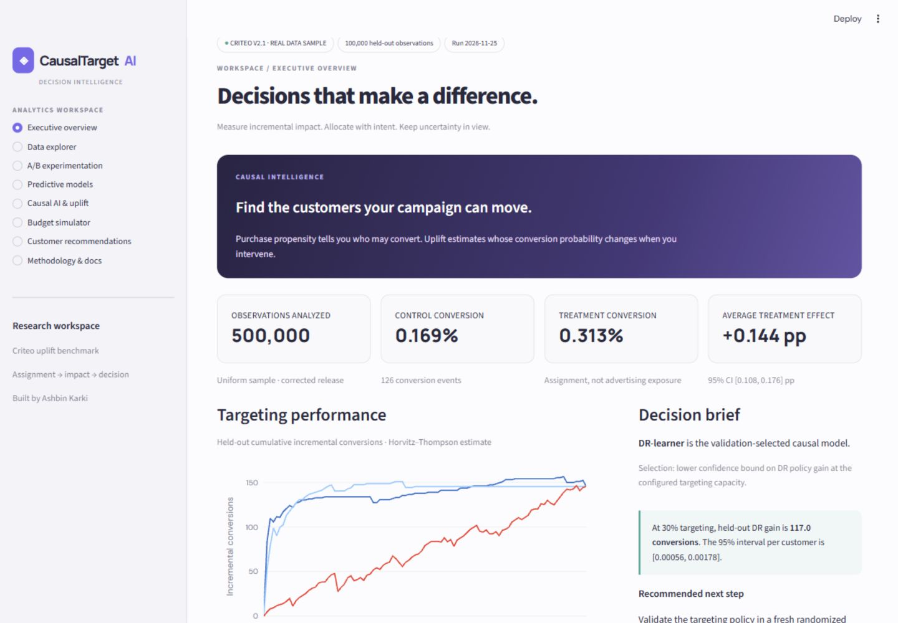
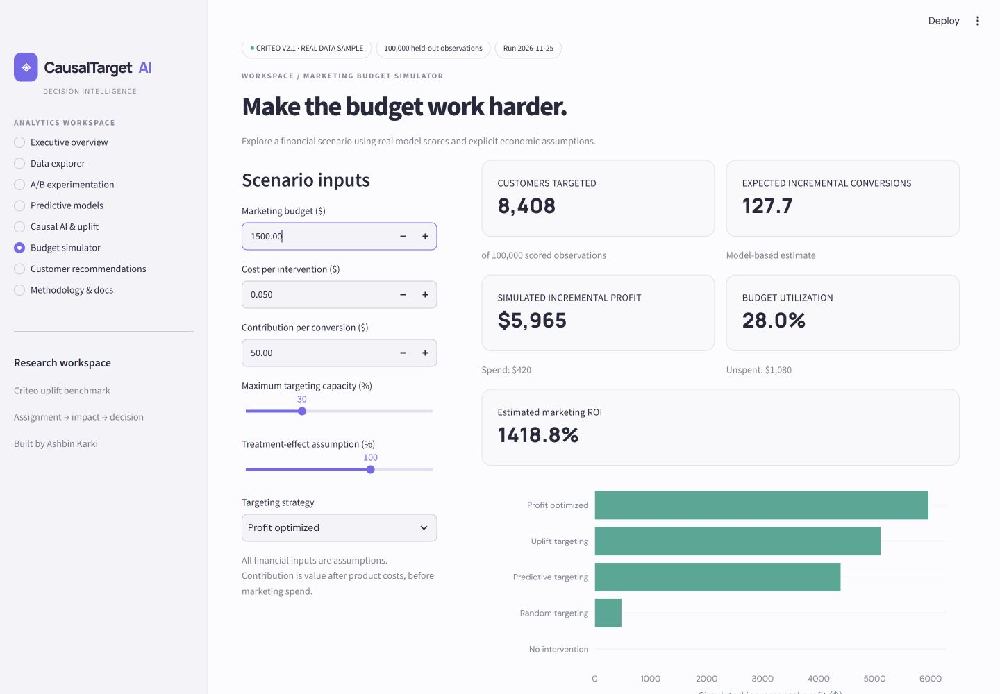
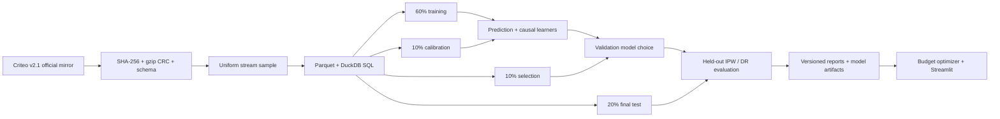
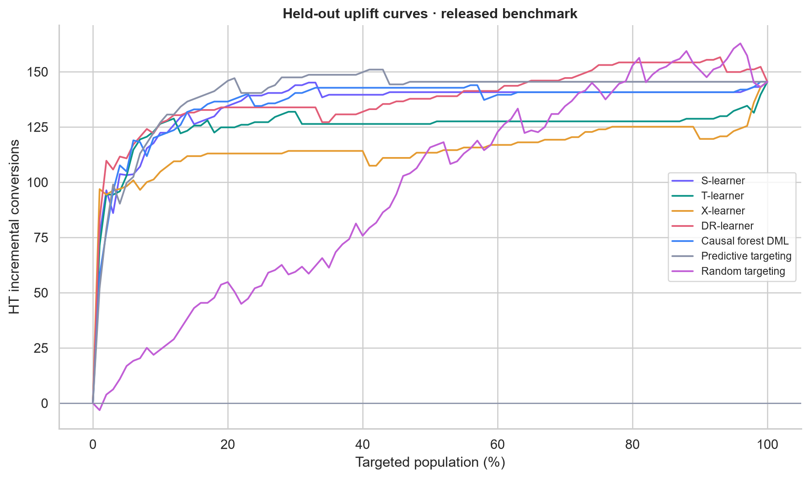

<p align="center"></p>

# CausalTarget AI

### Causal AI for Intelligent Customer Targeting and Business Decision Optimization

   

**Spend on customers whose behavior can change.** CausalTarget AI combines an experimental-data pipeline, calibrated purchase prediction, five causal learners, statistically explicit policy evaluation and a budget simulator in an eight-page analytics application.

This is a reproducible, production-oriented **portfolio benchmark**, not a deployed company marketing system. All numeric results below come from executed Criteo experiments. Financial figures are simulations with configurable assumptions.



## Measured result, including the inconvenient part

The executed demo scanned **13,979,592** source rows, retained a uniform **500,000**-row sample, and reserved **100,000** observations for final evaluation. Validation selected **Random forest** for purchase prediction and **DR-learner** for causal ranking.

At 30% targeting, the DR learner estimates **116.95 incremental conversions**, with a fixed-model normal 95% interval of **55.52 to 178.38**. The paired difference versus predictive targeting is **-4.14 conversions** (95% CI **-36.28 to +27.99**). This run does **not** establish superiority over the predictive baseline. LightGBM has the highest test average precision, but the preselected Random Forest is retained: test results do not retroactively change model selection.

The control conversion rate is **0.169%**, treatment conversion **0.313%**, and released-sample intention-to-treat difference **0.144 percentage points** (95% Newcombe interval 0.108–0.176 pp). The original campaign's effect cannot be recovered from the privacy-sampled release.

## Business problem

A likely buyer may buy without an advertisement. Ranking customers only by purchase probability can allocate spend to conversions that would happen anyway. The project asks a different question: which eligible observations have positive expected incremental contribution from intervention, under a budget and capacity limit?

Objectives are to measure treatment lift, compare targeting policies on held-out randomized assignments, expose uncertainty, and translate CATE into an auditable financial scenario. No actual Criteo revenue, cost or margin data is available.

## Application

1. **Executive overview:** experiment KPIs, selected model, uplift and simulated strategy comparison.
2. **Data explorer:** assignment filters, feature-range filters over aggregated bins, missingness, correlations and quality diagnostics.
3. **A/B experimentation:** assignment conversion, Z/chi-square tests, Newcombe/bootstrapped intervals, balance and prospective power.
4. **Predictive models:** ROC/PR/calibration, confusion matrices, validation-selected thresholds and predictive SHAP.
5. **Causal AI & uplift:** S/T/X/DR/forest comparisons, AUUC/Qini, paired policy comparisons and subgroup uncertainty.
6. **Budget simulator:** live budget/cost/value/capacity/effect assumptions, six strategies, sensitivity and CSV export.
7. **Customer recommendations:** anonymous source IDs, probabilities, CATE, value, filtering, sorting and export.
8. **Methodology & docs:** assumptions, provenance, reports and drift diagnostics.



## Quick start

Install [uv](https://docs.astral.sh/uv/getting-started/installation/) using its official instructions. Python 3.12 is selected by `.python-version`; uv can install it automatically. From the repository root:

```bash
uv sync --frozen --extra forest
uv run streamlit run app/main.py
```

The committed, compact real-data report bundle makes the app usable **without downloading data or retraining**. Visit the localhost URL printed by Streamlit. No credentials are needed. Streamlit's Settings menu supports theme selection; the checked-in default is light.

Windows PowerShell also supports:

```powershell
.\scripts\run.ps1 -Task setup
.\scripts\run.ps1 -Task app
```

In the original development workspace, a local uv executable is available at `.tools\bin\uv.exe`; the PowerShell helper detects it. This bootstrap directory is excluded from Git.

## Reproduce the experiment

```bash
uv run causal-target download
uv run causal-target process --profile demo
uv run causal-target run --profile demo
uv run causal-target evaluate
uv run python scripts/build_documentation.py
```

`run` includes ingestion, validation, SQL, EDA, training, evaluation, optimization, reports, figures, model serialization and MLflow logging. `train` is an alias for this auditable end-to-end run. `evaluate` displays the saved untouched-test results; it does not retrain or retune on test outcomes.

| Profile | Retained data | Purpose | Forest training cap |
| --- | ---: | --- | ---: |
| Quick | 20,000 | Synthetic smoke tests; real quick samples may lack rare control events | Disabled |
| Demo | 500,000 | Executed portfolio benchmark | 60,000 training rows |
| Full | All 13,979,592 | Larger workstation experiments; not executed here | 250,000 training rows |

```bash
uv run causal-target run --profile quick --source synthetic
uv run causal-target run --profile full
```

Synthetic runs write to `reports/runs/synthetic/` so they cannot replace the real portfolio bundle. Full training requires at least 12 GiB **available** memory (a safety floor, not a peak-memory guarantee); allow substantially more for large copies/forests. Demo uses four worker threads. No GPU is required. The verified model/report computation took about 35 seconds on this host, excluding initial environment installation and the first archive scan; it is not a portable performance guarantee.

## Data and integrity

- Corrected **Criteo v2.1**, 12 anonymized baseline features plus treatment, conversion, visit and exposure.
- Official source: [Criteo AI Lab](https://ailab.criteo.com/criteo-uplift-prediction-dataset/); actual download: [Criteo's Hugging Face repository](https://huggingface.co/datasets/criteo/criteo-uplift).
- The old Azure host no longer resolved during execution. The ingestion pipeline uses pinned revision `82811785048bb633de2d55c02bab4e57066e6423`.
- Archive SHA-256: `2716e1bf0fd157a93b5bf86924d9088419dfbac2022c6cd90030220634f616dc`. Verified against the publisher's hash, gzip CRC, schema and expected source row count.
- Uniform IID-priority reservoir sampling scans every row and never stratifies the sampling step on outcomes. The 60/10/10/20 modeling split is stratified on assignment and outcome.
- 1,456 observed conversions in the demo; no missing feature/label values. 3,973 matching feature rows retained because anonymized equality does not prove duplicate identity.
- Data and derived artifacts: **CC BY-NC-SA 4.0**, separate from MIT code. Raw observations and binary model files are ignored. See [data terms](DATA_LICENSE.md) and [data dictionary](docs/data-dictionary.md).

## Architecture and stack



Python 3.12, uv, Polars/Pandas/NumPy, Parquet/PyArrow, DuckDB SQL, SciPy/Statsmodels, scikit-learn, LightGBM, Optuna, EconML, SHAP, MLflow, Streamlit/Plotly, Pytest/Ruff and Docker/GitHub Actions. The dashboard needs only a small subset of this stack. A separate React/FastAPI service and PostgreSQL are unnecessary for precomputed local analytics; see [architecture decisions](docs/architecture/decisions.md).

## Methods and evaluation

**Prediction:** Logistic Regression, Random Forest and LightGBM; five seeded Optuna LightGBM trials; train-only scaling/imputation; independent sigmoid calibration; validation average precision for selection and validation F1 for thresholds. No class resampling is used because calibrated probability quality matters. Report ROC-AUC alongside average precision, log loss, Brier, precision/recall/F1 and confusion matrices.

| model | roc_auc | pr_auc | log_loss | brier | f1 |
| --- | --- | --- | --- | --- | --- |
| Logistic regression | 0.955183 | 0.223549 | 0.0121778 | 0.00253971 | 0.301824 |
| Random forest | 0.964954 | 0.242422 | 0.014977 | 0.00261961 | 0.301115 |
| LightGBM | 0.965704 | 0.250833 | 0.0115455 | 0.00247153 | 0.322702 |

**Causality:** S-, T-, X-, cross-fitted DR learner and honest Causal Forest DML. Use only `f0`–`f11`; exposure and visit cannot enter ordinary predictors. Original per-trial assignment probabilities are unavailable, so the training assignment fraction (0.850537) is an explicit benchmark assumption, not a claimed known design probability.

| model | qini | auuc | dr_incremental_conversions |
| --- | --- | --- | --- |
| S-learner | 0.000624091 | 0.00135148 | 117.17 |
| T-learner | 0.000523923 | 0.00125132 | 112.31 |
| X-learner | 0.000425487 | 0.00115288 | 88.7303 |
| DR-learner | 0.000656101 | 0.00138349 | 116.951 |
| Causal forest DML | 0.000627191 | 0.00135458 | 114.074 |
| Predictive targeting | 0.000672911 | 0.0014003 | 121.095 |
| Random targeting | 0.000233421 | 0.000960814 | 55.6344 |

AUUC integrates normalized Horvitz–Thompson cumulative incremental outcomes over targeted fraction; Qini subtracts the straight-line random baseline area. DR policy gain is incremental to treating nobody. The test-set nuisance models are fitted only on training data. Bootstrap and normal policy intervals condition on the fitted models and propensity, excluding training/selection uncertainty. Quantile/half-test results are exploratory and not multiplicity-adjusted. See [mathematical methodology](docs/methodology/causal-inference.md), [evaluation report](reports/model-evaluation.md) and [model card](docs/model_cards/selected-models.md).



## Business optimization: explicitly simulated

Maximize `sum(decision_i * (CATE_i * contribution_value - intervention_cost))`, subject to budget and targeting capacity. Equal costs make sorting exact; negative-value interventions are skipped. Treat-everyone is flagged infeasible when it would violate constraints.

At the default $1,500 budget, $0.05 intervention cost, $50 contribution per conversion and 30% capacity, profit optimization selects **8,408 observations**, spends **$420.40**, and estimates **$5,964.68 simulated incremental profit**. The separate held-out DR evaluation estimates 102.62 incremental conversions (95% CI 41.77–163.47). The model-based scenario and experimental policy estimate are different estimators, not interchangeable financial facts.

| strategy | feasible | targeted | spend | incremental_profit | heldout_dr_conversions |
| --- | --- | --- | --- | --- | --- |
| No intervention | True | 0 | 0 | 0 | 0 |
| Random targeting | True | 30000 | 1500 | 405.492 | 55.6344 |
| Treat everyone | False | 0 | 0 | 0 | 0 |
| Predictive targeting | True | 30000 | 1500 | 4395.64 | 121.095 |
| Uplift targeting | True | 30000 | 1500 | 5109.23 | 116.951 |
| Profit optimized | True | 8408 | 420.4 | 5964.68 | 102.62 |

Do not describe these amounts as money saved or revenue generated at Criteo. The next business step would be a fresh randomized campaign with measured costs, eligibility and contribution margins.

## Testing and lifecycle

```bash
uv run pytest --cov=causal_target --cov-report=term-missing
uv run ruff check src app tests scripts
uv run ruff format --check src app tests scripts
uv run python scripts/verify_bundle.py
uv run python scripts/secret_scan.py
```

Tests cover ingestion/checksums, strict schema, disjoint splits, leakage exclusion, known-effect synthetic recovery, DR robustness, policy accounting, optimization against exhaustive search, zero/negative/invalid cases, serialization/inference, drift and all eight application views. Actual browser QA checked desktop/mobile layout, navigation, simulator recalculation and a 100,000-row CSV download. See [verification evidence](docs/verification.md) for final counts and unexecuted checks.

```bash
uv run causal-target predict --input data/processed/demo/observations.parquet --output artifacts/batch-scores.csv
uv run causal-target monitor --reference data/processed/demo/observations.parquet --input data/processed/demo/observations.parquet --output artifacts/drift.csv
uv run mlflow ui --backend-store-uri sqlite:///mlflow.db
```

The monitoring example compares a dataset with itself to demonstrate invocation; replace `--input` with a new **baseline-schema** cohort for meaningful drift monitoring. PSI uses training-defined bins; KS is descriptive. Model manifests record checksums and package versions. Only load trusted local joblib artifacts.

## Deployment

```bash
docker compose up --build
```

The non-root container serves precomputed reports on port 8501 with a health check. Docker is not installed on the development host, so local image execution is **not verified**; CI includes a build and health smoke test. Streamlit Community Cloud is the recommended demonstration host; `app/requirements.txt` is a separate hashed runtime lock. Select Python 3.12 and `app/main.py`. No public deployment URL is claimed. [Deployment guide](docs/deployment.md).

## Repository map

```text
app/                 Eight Streamlit views, shared UI/data components, runtime lock
configs/             Quick / demo / full experiment profiles
src/causal_target/   Data, statistics, prediction, causality, evaluation, optimization
                     Monitoring, batch inference, reporting, CLI orchestration
sql/                 CTEs, window functions, experiment/segment/quality analytics
tests/               Unit, integration, known-effect and dashboard tests
reports/metrics/     Verified portable summaries and derived score table
reports/figures/     Actual statistical/model/explainability figures
notebooks/           Review notebooks backed by generated reports
docs/                Architecture, methodology, deployment, screenshots and career package
scripts/             Windows runner, documentation builder, checks
.github/workflows/   Test/lint/reproducibility and container CI
```

## Limitations and next experiments

Rare control conversions constrain heterogeneity estimates. The original experiment uses pooled, privacy-sampled data and anonymized features; customer identity, campaign costs, demographics and original design metadata are unavailable. Model-specific CATE intervals exist for the forest only; the selected DR learner has subgroup/policy intervals rather than valid individual intervals. No full-scale training, live production monitoring or real-campaign deployment was performed. Additional experiments should evaluate multiple training seeds, advertiser/time generalization when identifiers are available, richer cost structures and a preregistered fresh randomized holdout. DoWhy is not forced into a randomized benchmark where the identification argument can be stated directly.

## Portfolio and attribution

- [Portfolio case study](docs/portfolio-case-study.md) · [structured metadata](docs/project-metadata.json)
- [Resume / LinkedIn / interview package](docs/career/README.md)
- [Experiment report](reports/experimentation.md) · [Executive report](reports/executive_summary/report.md)
- [Troubleshooting](docs/troubleshooting.md) · [Project status](PROJECT_STATUS.md)

**Ashbin Karki** — Master's in Data Science and AI, specializing in Artificial Intelligence. This portfolio project was developed with AI-assisted implementation and validation; it is not a claim of employment or production impact at Criteo.

Dataset citation: Diemert, Betlei, Renaudin and Amini (2018), *A Large Scale Benchmark for Uplift Modeling*, AdKDD and TargetAd Workshop, KDD. Original code: [MIT](LICENSE). Data-derived artifacts: [CC BY-NC-SA 4.0](DATA_LICENSE.md).
