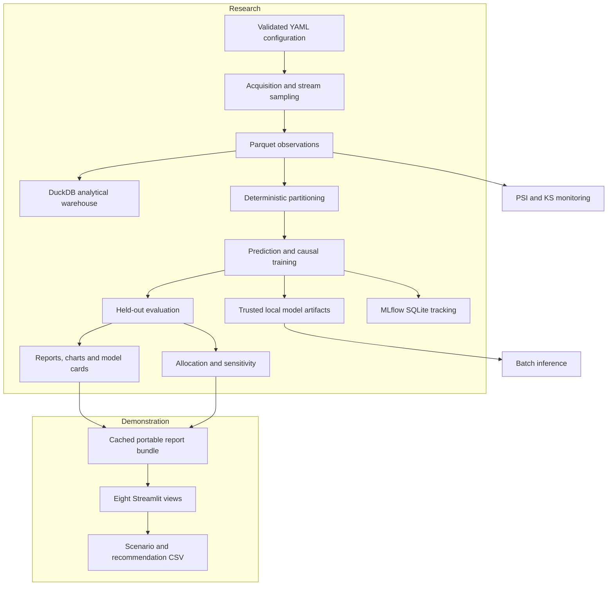

# Technical architecture report

The source of truth is the checked-in Python pipeline and its generated run manifest. Notebooks are read-only review entry points; the dashboard is a consumer of executed outputs.

## Interfaces

`causal-target download` acquires and verifies a known archive. `process` scans, validates and converts it. `run`/`train` execute the full lifecycle. `evaluate` reads the recorded final evaluation. `predict` reads a trusted model plus its integrity manifest and validates baseline features. `monitor` compares two Parquet cohorts using reference-defined bins. Output roots isolate synthetic tests from the real bundle.

Configuration validation rejects unsupported profiles, invalid financial inputs, noninteger resource limits, invalid propensity and empty/tiny sample sizes. Application controls enforce bounded nonnegative financial inputs. Pipeline failures raise actionable errors rather than substituting synthetic data silently.

## Artifact contracts

- `data/raw/download.json`: URL, version, publisher hash, gzip verification, size and timestamp.
- `data/processed/<profile>/manifest.json`: raw hash, processed hash, seed, full stream count and sample design.
- `artifacts/model_manifest.json`: joblib checksum, package versions and training-data provenance.
- `reports/metrics/summary.json`: configuration, partition counts, selected models, statistics, causal diagnostics and MLflow run ID.
- `reports/metrics/targeting.parquet`: source-row ID, purchase probability and selected CATE; forest bounds only if that learner is selected.
- `reports/metrics/forest_intervals.csv`: optional forest-only diagnostic sample; not falsely attached to the DR learner.

## Resource and operational behavior

The measured host has 20 logical CPUs and 24.82 GB RAM; only about 4.1 GB was initially available. Demo uses four threads, 500,000 retained rows and a 60,000-row forest cap. Download plus processing is separate from the measured model/report compute time. Model startup is absent from the public app, so serving does not need the full data or fitted forests.

The app is nontransactional and has no credentials, customer contact integrations, writeback endpoint or public campaign execution action. Downloads are generated in memory. Health checks assess HTTP readiness, while AppTest/browser checks assess actual pages and controls. Production campaign integration would require authentication, audit logs, fresh experiment design, consent/eligibility enforcement and explicit data contracts.
