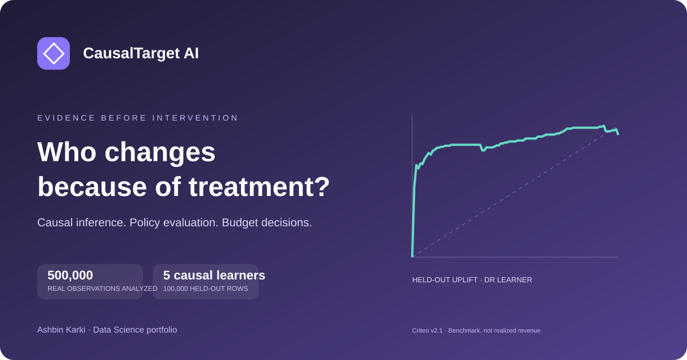
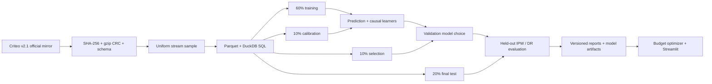
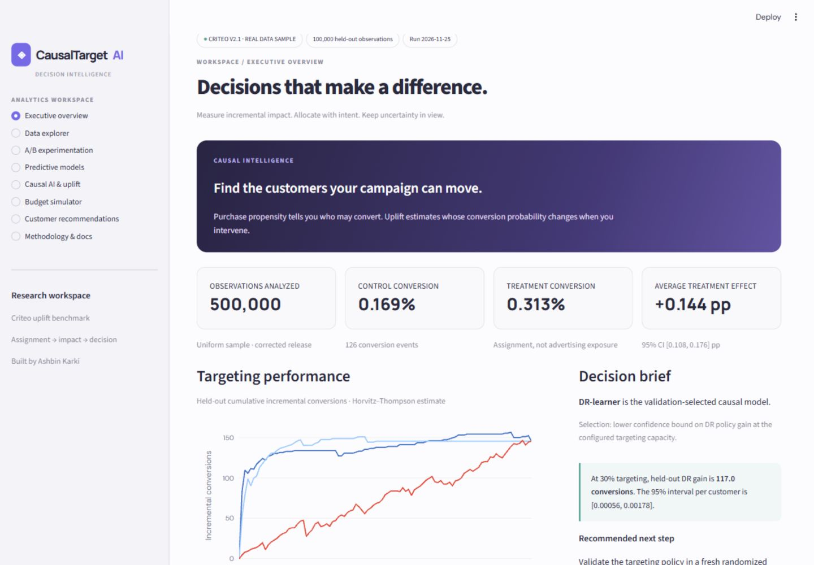
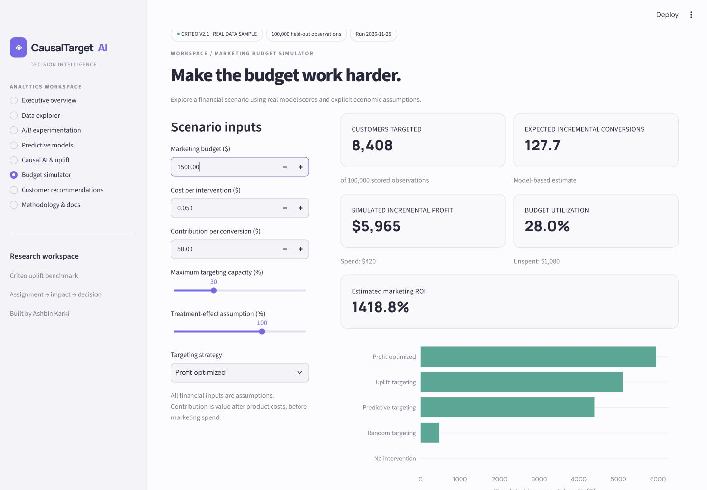

# CausalTarget AI — portfolio case study

## Summary
An end-to-end Data Science portfolio project connecting randomized experimentation, purchase prediction, causal machine learning and marketing allocation in a working decision-support application.

## Business problem and decision
High purchase probability does not imply high incremental response. The project separates those questions, estimates CATE, and allocates a constrained budget only where expected incremental contribution is positive.

## Evidence
The executed demo scanned **13,979,592** source rows, retained a uniform **500,000**-row sample, and reserved **100,000** observations for final evaluation. Validation selected **Random forest** for purchase prediction and **DR-learner** for causal ranking.

The selected predictive model achieved test ROC-AUC **0.9650** and average precision **0.2424**. At 30% targeting, the DR learner estimates **116.95 incremental conversions**, with a fixed-model normal 95% interval of **55.52 to 178.38**. The paired difference versus predictive targeting is **-4.14 conversions** (95% CI **-36.28 to +27.99**). This run does **not** establish superiority over the predictive baseline. LightGBM has the highest test average precision, but the preselected Random Forest is retained: test results do not retroactively change model selection.

## Architecture

## Technical approach
Use an official corrected dataset, verify its SHA-256 and gzip CRC, scan the entire release with uniform reservoir sampling, validate schema, and persist Parquet/DuckDB tables. Use independent train/calibration/selection/test partitions, train three predictive and five causal models, estimate IPW/DR policy values and paired intervals, then expose decisions through Streamlit and Plotly. Track runs in MLflow; validate with Pytest, Ruff and browser QA.

## Business scenario
At explicitly assumed $0.05 intervention cost and $50 contribution, the optimizer selected 8,408 of 100,000 observations, left $1,079.60 of a $1,500 budget unspent, and estimated $5,964.68 model-based incremental profit. These are simulated outcomes, not realized company savings.

## Challenges and lessons
The historical download host had disappeared; the publisher-owned Hugging Face mirror and published checksum preserved provenance. Rare control conversions required cautious interpretation. A complex causal learner did not establish superiority over predictive targeting, illustrating why paired held-out evaluation matters. Uniform costs permit exact sorting without unnecessary optimization infrastructure. Precomputed artifacts separate expensive research from a lightweight interactive demo.

## Boundaries
Privacy sampling obscures original campaign lift; features cannot be given invented business meanings. No raw customer identity or actual cost/revenue data is available. Forest training is resource-capped and full-scale training was not executed. Deployment configuration is prepared; public URL is recorded only after verified hosting. Repository and live links, when verified, are stored in project-metadata.json.

Author: Ashbin Karki. AI-assisted portfolio development; no claimed employer deployment. Code MIT; Criteo data-derived artifacts CC BY-NC-SA 4.0.
